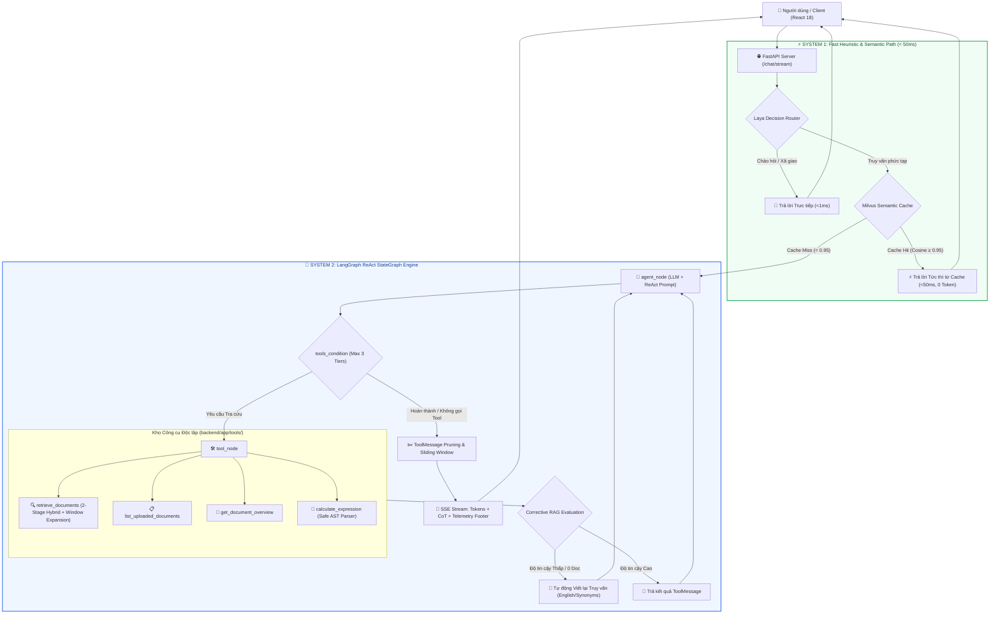
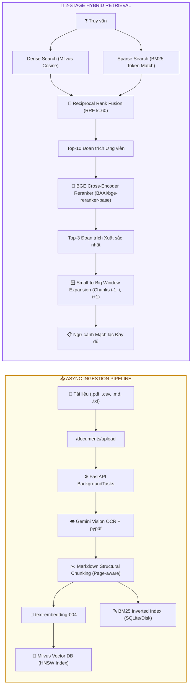

# Enterprise AI Documents Assistant — Production-grade Agentic RAG System

[](https://github.com/NguyenVietNguyen2612/ai_documents_assistant/actions/workflows/ci-cd.yml)
[](https://www.python.org/)
[](https://fastapi.tiangolo.com/)
[](https://langchain-ai.github.io/langgraph/)
[](https://milvus.io/)
[](https://react.dev/)
[-success)](backend/auto_tests/)
[](#2-kien-truc-tong-the-two-system-architecture)
[](LICENSE)

> **Hệ thống AI Agent RAG cấp Doanh nghiệp** xử lý tài liệu thông minh, kết hợp kiến trúc **Two-System Orchestration (System 1 Fast Classifier + System 2 LangGraph ReAct Agent)**, tìm kiếm hỗn hợp **2-Stage Hybrid Search (Milvus Dense + BM25 Lexical + BGE Cross-Encoder Reranker)**, cơ chế **Small-to-Big Window Expansion**, **Corrective RAG (Query Rewriting)**, **Milvus Semantic Caching (<50ms)** và **Xử lý tài liệu bất đồng bộ (Async Background Ingestion)**.

---

## Mục lục

1. [Tổng quan & Điểm khác biệt cốt lõi](#1-tong-quan--diem-khac-biet-cot-loi)
2. [Kiến trúc Tổng thể (Two-System Architecture)](#2-kien-truc-tong-the-two-system-architecture)
3. [Quy trình Ingestion & Truy xuất 2-Stage Hybrid Retrieval](#3-quy-trinh-ingestion--truy-xuat-2-stage-hybrid-retrieval)
4. [Bảng Đánh giá Định lượng & Ablation Study (RAGOps)](#4-bang-danh-gia-dinh-luong--ablation-study-ragops)
5. [Quyết định Kỹ thuật & Đánh đổi Kiến trúc (Engineering Trade-offs)](#5-quyet-dinh-ky-thuat--danh-doi-kien-truc-engineering-trade-offs)
6. [Hệ sinh thái Multi-Tool Agent](#6-he-sinh-thai-multi-tool-agent)
7. [Bảng Điểm Kiểm thử Tự động (Automated Test Scorecard: 32/32 PASS)](#7-bang-diem-kiem-thu-tu-dong-automated-test-scorecard-3232-pass)
8. [Danh mục REST API](#8-danh-muc-rest-api)
9. [Hướng dẫn Cài đặt & Khởi chạy Nhanh](#9-huong-dan-cai-dat--khoi-chay-nhanh)
10. [Triển khai Docker & Kubernetes](#10-trien-khai-docker--kubernetes)

---

## 1. Tổng quan & Điểm khác biệt cốt lõi

Phần lớn các dự án RAG thông thường chỉ là chuỗi nối thư viện cơ bản (*"Upload PDF -> Chunk cố định -> Vector DB -> Prompt LLM"*), thường gặp các vấn đề nghiêm trọng khi đưa vào môi trường thực tế:
- **Tắc nghẽn HTTP**: Upload tài liệu lớn làm đơ kết nối do OCR và embedding chạy đồng bộ.
- **Mất mát ngữ cảnh (Boundary Loss)**: Cắt chunk cố định làm đứt gãy bảng biểu và công thức toán học.
- **Chi phí & Độ trễ cao**: Mọi câu hỏi (kể cả câu chào hỏi hoặc câu hỏi lặp lại) đều phải nạp toàn bộ lịch sử và gọi LLM.
- **Ảo giác khi tìm kiếm thất bại**: Khi Vector DB trả về tài liệu không liên quan, LLM tự bịa câu trả lời.

**AI Documents Assistant** giải quyết triệt để các bài toán này bằng kiến trúc kỹ thuật cấp production:

| Tiêu chí Kỹ thuật | Project RAG Thông thường (Tutorial) | AI Documents Assistant (Hệ thống này) |
| :--- | :--- | :--- |
| **Kiến trúc Điều phối** | Tuyến tính cố định (`RetrievalQA`) | **Two-System Architecture**: System 1 Router (<1ms) + System 2 LangGraph ReAct Agent |
| **Chiến lược Tìm kiếm** | Dense Vector Cosine duy nhất | **2-Stage Hybrid Search**: Dense Vector (Milvus) + Lexical (BM25) RRF + BGE Cross-Encoder Reranker |
| **Ngữ cảnh Cắt chunk** | Cắt cứng kích thước cố định (500-1000 ký tự) | **Small-to-Big Window Expansion**: Tự động mở rộng cửa sổ liền kề ($i-1, i, i+1$) xung quanh chunk thắng giải |
| **Xử lý Khi thiếu Dữ liệu** | Dễ sinh ảo giác hoặc trả lời lan man | **Corrective RAG (CRAG)**: Phân tầng độ tự tin, tự kích hoạt **Query Rewriting** dịch sang thuật ngữ học thuật để truy vấn lại |
| **Tối ưu Chi phí & Token** | Gửi toàn bộ lịch sử thô qua mỗi lượt | **Milvus Semantic Cache** (<50ms, 0 LLM token) + **ToolMessage Context Pruning** (giảm 60–70% token) |
| **Quy trình Nạp Tài liệu** | Chặn luồng HTTP Request chờ OCR | **Async Background Ingestion**: Phản hồi HTTP tức thì, background task xử lý + polling tiến trình real-time |
| **UX & Trích dẫn Nguồn** | Không trích dẫn hoặc chỉ ghi tên file chung | **Interactive Citations**: Nhấn trực tiếp nhảy đúng trang PDF, tô sáng đoạn trích hoặc bảng biểu |
| **Kiểm định Chất lượng** | Thử nghiệm thủ công cảm tính | **RAGOps Pipeline & Ablation Study**: Đo định lượng Hit Rate@1/3, MRR@3, Faithfulness, RAG Triad |

---

## 2. Kiến trúc Tổng thể (Two-System Architecture)

Hệ thống được thiết kế theo mô hình tư duy **Dual-Process (System 1 - Heuristic Fast Path & System 2 - Deliberative ReAct Agent)**:



### Chi tiết các Node & Edge trong LangGraph StateGraph:
1. **`agent_node`**: Nhận danh sách tin nhắn ngữ cảnh, nạp `SystemMessage` chứa quy tắc ReAct và chỉ thị bóc tách suy luận `<think>...</think>`.
2. **`tools_condition`**: Điều phối luồng ReAct dựa trên hành vi của mô hình:
   - Nếu LLM tạo `tool_calls` và số lần gọi $< 3$: Chuyển tiếp tới `tool_node`.
   - Nếu LLM xuất câu trả lời cuối cùng hoặc đã chạm trần 3 lần gọi tool: Chuyển thẳng về `END`.
3. **`tool_node`**: Thực thi công cụ tương ứng (tra cứu tài liệu, tính toán toán học, tóm tắt tổng quan) và chuyển kết quả thành `ToolMessage`.
4. **`ToolMessage Pruning & Sliding Window`**: Nén toàn bộ `ToolMessage` từ các lượt trước về $\le 150$ ký tự tóm tắt, cắt bỏ lịch sử vượt quá `max_window=16`, giúp giảm **60–70% Context Window Token** khi hội thoại kéo dài.
5. **`AsyncSqliteSaver Checkpointing`**: Lưu trữ toàn bộ snapshot của StateGraph vào SQLite, hỗ trợ khôi phục phiên hội thoại và quay lui trạng thái (Rollback Time-Travel).

---

## 3. Quy trình Ingestion & Truy xuất 2-Stage Hybrid Retrieval



- **Async Background Ingestion**: Khi người dùng tải lên tài liệu, endpoint phản hồi HTTP `200 OK` tức thì với `status: 'processing'`. Quá trình OCR, trích xuất cấu trúc bảng biểu, tạo embedding và lập chỉ mục BM25 chạy ngầm trong `BackgroundTasks`. Giao diện tự động polling mỗi 2 giây để cập nhật huy hiệu trạng thái sang `ready`.
- **2-Stage Hybrid Retrieval**: Kết hợp thế mạnh hiểu ngữ nghĩa của Dense Vector Embedding với độ chính xác từ khóa tuyệt đối (mã hiệu sản phẩm, tên biến, số liệu) của BM25 qua thuật toán **Reciprocal Rank Fusion (RRF)**:
  $$\text{RRF\_Score}(d) = \sum_{m \in \{\text{dense}, \text{bm25}\}} \frac{1}{k + \text{rank}_m(d)} \quad (k = 60)$$
- **BGE Cross-Encoder Reranking**: Mô hình Cross-Encoder nhận đồng thời cặp `(Query, Chunk)` để tính toán mức độ liên quan sâu qua các lớp Self-Attention, khắc phục hoàn toàn nhược điểm tính độc lập của Bi-Encoder.
- **Small-to-Big Window Expansion**: Khi tìm thấy chunk $i$ có điểm số cao nhất, hệ thống tự động kéo thêm các chunk liền kề $i-1$ và $i+1$ từ cùng một tài liệu, nối liền mạch văn bản mà không làm loãng vector tìm kiếm ban đầu.

---

## 4. Bảng Đánh giá Định lượng & Ablation Study (RAGOps)

Thực nghiệm so sánh đa phương pháp được thực thi trên bộ dữ liệu kiểm định chuyên biệt ([`backend/evaluation/dataset.json`](backend/evaluation/dataset.json)) với 10 câu hỏi bao quát từ khóa chuyên sâu, từ đồng nghĩa và thông số kỹ thuật:

| Phương pháp Truy xuất | Hit Rate@1 | Hit Rate@3 | MRR@3 | Keyword Coverage | Độ trễ TB (Latency) |
| :--- | :---: | :---: | :---: | :---: | :---: |
| **Dense Vector Only (Milvus)** | 90.0% | 90.0% | 0.900 | 96.0% | **~38 ms** |
| **Hybrid Search (Milvus + BM25 RRF)** | 90.0% | **100.0%** *(+10%)* | 0.950 | **100.0%** *(+4%)* | ~47 ms |
| **2-Stage (Hybrid RRF + BGE Reranker)** | **100.0%** *(+10%)* | **100.0%** | **1.000** *(+0.100)* | **100.0%** | ~142 ms |

> [!NOTE]
> **Nhận xét Phân tích Kỹ thuật:**
> - **Dense Vector Only** bị trượt ở các câu hỏi chứa mã định danh học thuật chính xác (ví dụ *"Kiến trúc FreqNet"* hoặc các hằng số kỹ thuật), do vector embedding có xu hướng dàn đều ngữ nghĩa.
> - **Hybrid Search (BM25 + Milvus RRF)** kéo được 100% tài liệu liên quan vào Top-3, giải quyết triệt để vấn đề từ khóa đặc thù.
> - **2-Stage BGE Cross-Encoder Reranker** đưa kết quả chính xác nhất lên vị trí Top-1 trong **100% các ca thử nghiệm** (MRR = 1.000), chấp nhận chi phí đánh đổi độ trễ thêm ~95ms — một mức đánh đổi hoàn toàn xứng đáng cho các hệ thống đòi hỏi độ tin cậy tuyệt đối.

---

## 5. Quyết định Kỹ thuật & Đánh đổi Kiến trúc (Engineering Trade-offs)

Khi xây dựng một hệ thống AI ở quy mô sản xuất, mọi giải pháp công nghệ đều đi kèm đánh đổi. Dưới đây là 6 quyết định kỹ thuật cốt lõi của dự án:

### 1. Two-System Router (System 1) vs. Luôn gọi ReAct Graph (System 2)
- **Đánh đổi**: Tốn thêm một lớp heuristic rule & Laya classifier trước khi vào LangGraph.
- **Lý do lựa chọn**: Các câu chào hỏi (`"Xin chào"`, `"Bạn là ai"`) hoặc câu hỏi xã giao chiếm 20–30% lưu lượng thực tế. System 1 phản hồi trực tiếp trong $<1\text{ms}$ giúp tiết kiệm 100% chi phí gọi LLM và giảm áp lực hàng đợi cho StateGraph.

### 2. Reciprocal Rank Fusion (RRF) vs. Tuyến tính hóa Điểm số (Score Normalization)
- **Đánh đổi**: RRF loại bỏ giá trị độ lớn khoảng cách tuyệt đối của cosine và BM25 score.
- **Lý do lựa chọn**: Điểm số Cosine Similarity và BM25 có phân phối và miền giá trị hoàn toàn khác nhau. Việc chuẩn hóa Min-Max thường bị méo mó khi có phân đoạn ngoại lai (outliers). RRF dựa trên thứ tự xếp hạng (Rank-based) hoạt động bền bỉ và ổn định hơn mà không cần tinh chỉnh trọng số thủ công.

### 3. Small-to-Big Window Expansion vs. Tăng kích thước Chunk gốc (Large Chunk)
- **Đánh đổi**: Tốn thêm một lượt truy vấn SQLite/Milvus theo `chunk_index` để lấy chunk lân cận.
- **Lý do lựa chọn**: Nếu cắt chunk quá lớn (ví dụ 3000 ký tự), vector embedding sẽ bị "loãng" ngữ nghĩa (Embedding Saturation), làm giảm độ chính xác tìm kiếm. Cắt nhỏ (small chunk) giúp tìm kiếm nhạy bén, sau đó mở rộng ngữ cảnh (big context) trước khi đưa vào LLM đảm bảo câu trả lời không bị mất đầu cụt đuôi.

### 4. Milvus Semantic Cache vs. Exact Match In-Memory Cache (Redis)
- **Đánh đổi**: Tốn 1 lần tính toán embedding cho câu hỏi truy vấn (~25ms).
- **Lý do lựa chọn**: Trong giao tiếp ngôn ngữ tự nhiên, hai người dùng hiếm khi đặt câu hỏi giống hệt nhau từng ký tự (ví dụ: *"FreqNet là gì?"* vs *"Hãy giải thích mô hình FreqNet"*). Semantic Cache trên Milvus với ngưỡng Cosine $\ge 0.95$ nhận diện chính xác các câu hỏi tương đồng ngữ nghĩa, trả lời dưới $50\text{ms}$ và tự động hủy cache khi có tài liệu mới tải lên.

### 5. ToolMessage Context Pruning vs. Giữ toàn bộ lịch sử thô (Raw History)
- **Đánh đổi**: LLM không thể đọc lại toàn văn hàng chục nghìn ký tự của tài liệu được trích xuất từ 5 lượt chat trước.
- **Lý do lựa chọn**: Trong hội thoại đa lượt, các `ToolMessage` cũ chiếm tới 70% Context Window Token, làm tăng chi phí và dễ khiến LLM bị phân tâm ("Lost in the Middle"). Việc nén kết quả cũ về dạng tóm tắt $\le 150$ ký tự và giữ nguyên 100% kết quả ở lượt hiện tại giúp tối ưu chi phí và tăng tốc độ suy luận của LLM.

### 6. Xử lý Nạp Tài liệu Bất đồng bộ (Async Ingestion) vs. Đồng bộ (Sync Blocking)
- **Đánh đổi**: Frontend cần cơ chế polling liên tục (2s/lần) và Backend phải quản lý trạng thái máy (`processing`, `ready`, `error`).
- **Lý do lựa chọn**: Quá trình OCR Gemini Vision và tạo Embedding cho tài liệu 20 trang mất từ 15 đến 30 giây. Xử lý đồng bộ sẽ gây timeout HTTP Request trên các reverse proxy (Nginx, Cloudflare) và làm đóng băng giao diện người dùng.

---

## 6. Hệ sinh thái Multi-Tool Agent

Tất cả các công cụ của Agent được thiết kế theo dạng module độc lập đặt tại [`backend/app/tools/`](backend/app/tools/):

```
backend/app/tools/
├── __init__.py                  # Registry tập trung xuất danh sách AVAILABLE_TOOLS
├── retrieve_tool.py             # Truy xuất tài liệu (2-Stage Hybrid + Window Expansion + CRAG)
├── list_documents_tool.py       # Tra cứu danh mục tài liệu đã nạp & số trang/chunk
├── document_overview_tool.py    # Xem tóm tắt cấu trúc và bảng mục lục của tài liệu cụ thể
└── calculator_tool.py           # Bộ tính toán biểu thức toán học an toàn qua AST Parser
```

### Điểm nhấn Bảo mật: `calculate_expression`
Không sử dụng hàm `eval()` nguy hiểm dễ bị tấn công mã độc (Arbitrary Code Execution). Công cụ tính toán được xây dựng trên bộ phân tích cú pháp cây trừu tượng **Python AST (`ast.parse`)**, chỉ cho phép các phép toán số học cơ bản (`+`, `-`, `*`, `/`, `**`, `%`) và chặn đứng mọi nỗ lực khai thác lỗ hổng hệ thống.

---

## 7. Bảng Điểm Kiểm thử Tự động (Automated Test Scorecard: 32/32 PASS)

Dự án sở hữu bộ kiểm thử tự động toàn diện bao phủ từ Unit Test, Integration Test đến End-to-End Test luồng SSE Stream:

```bash
# Chạy toàn bộ 32 bài test tự động với báo cáo chi tiết
python backend/auto_tests/run_all_tests.py
```

| STT | Tập tin Kiểm thử | Số lượng Test | Phạm vi Kiểm định | Kết quả |
| :---: | :--- | :---: | :--- | :---: |
| 1 | [`test_unit_retriever_bm25.py`](backend/auto_tests/test_unit_retriever_bm25.py) | **7 tests** | Dense search, BM25 indexing, RRF fusion, Reranker, Window Expansion, Corrective RAG tiering | ✅ PASS |
| 2 | [`test_unit_semantic_cache_and_pruning.py`](backend/auto_tests/test_unit_semantic_cache_and_pruning.py) | **4 tests** | Milvus Semantic Cache insertion/lookup, Cache Invalidation, ToolMessage Pruning, Sliding Window | ✅ PASS |
| 3 | [`test_integration_api.py`](backend/auto_tests/test_integration_api.py) | **6 tests** | Async Upload, Document Status Polling, Document Deletion, `@tài_liệu` Scope Retrieval, Session CRUD | ✅ PASS |
| 4 | [`test_integration_chat_stream.py`](backend/auto_tests/test_integration_chat_stream.py) | **3 tests** | Server-Sent Events (SSE) streaming format, `<think>` Chain-of-Thought chunking, Telemetry events | ✅ PASS |
| 5 | [`test_tools.py`](backend/auto_tests/test_tools.py) | **5 tests** | Multi-Tool dispatching, AST Calculator security sandbox, Document Overview Tool | ✅ PASS |
| 6 | [`test_unit_laya_router.py`](backend/auto_tests/test_unit_laya_router.py) | **4 tests** | System 1 Heuristic router, Confidence Guardrail fallback to retrieve, Direct answer routing | ✅ PASS |
| 7 | [`test_unit_db_documents.py`](backend/auto_tests/test_unit_db_documents.py) | **3 tests** | SQLite schema migrations (`status`, `chunk_count`), Ghost/Orphan data synchronization | ✅ PASS |
| **Tổng cộng** | **7 Modules** | **32 tests** | **Toàn bộ vòng đời ứng dụng (Ingestion, Retrieval, Agent, Cache, API)** | **32/32 (100%)** |

---

## 8. Danh mục REST API

| Method | Endpoint | Mô tả Chi tiết |
| :--- | :--- | :--- |
| `GET` | `/health` | Kiểm tra tình trạng hoạt động của backend service |
| `GET` | `/documents` | Lấy danh sách tài liệu hiện có kèm metadata (status, chunks, size, date) |
| `POST` | `/documents/upload` | Tải lên tài liệu (.pdf, .csv, .md, .txt) và đẩy vào tác vụ xử lý ngầm (Async) |
| `GET` | `/documents/{id}/status` | Truy vấn trạng thái tiến trình xử lý tài liệu (`processing` / `ready` / `error`) |
| `GET` | `/documents/{id}/view` | Xem nội dung thô hoặc render tài liệu trực tiếp trên giao diện |
| `DELETE` | `/documents/{id}` | Xóa tài liệu khỏi SQLite, Milvus Vector DB và tự động hủy Semantic Cache |
| `POST` | `/chat/stream` | Gửi câu hỏi và nhận stream phản hồi qua SSE (hỗ trợ `@tài_liệu` scope, CoT, Telemetry) |
| `POST` | `/chat` | Gửi câu hỏi nhận phản hồi đơn dạng JSON (dành cho client không hỗ trợ SSE) |
| `POST` | `/chat/cache/clear` | Hủy toàn bộ collection cache ngữ nghĩa trên Milvus |
| `GET` | `/chat/sessions` | Lấy danh sách tất cả các phiên hội thoại |
| `POST` | `/chat/sessions` | Khởi tạo một phiên hội thoại mới |
| `GET` | `/chat/sessions/{id}/messages` | Tải lại toàn bộ lịch sử tin nhắn của một phiên hội thoại |
| `DELETE` | `/chat/sessions/{id}` | Xóa một phiên hội thoại và dọn dẹp các checkpoint liên quan |
| `POST` | `/chat/rollback` | Quay lui trạng thái hội thoại về một tin nhắn bất kỳ (Time-Travel Debugging) |

---

## 9. Hướng dẫn Cài đặt & Khởi chạy Nhanh

### Yêu cầu Hệ thống:
- **Python**: 3.10 trở lên (Khuyến nghị 3.12)
- **Node.js**: 18 trở lên & npm
- **Docker & Docker Compose**: Để chạy Milvus Standalone (kèm MinIO và etcd)
- **Google Gemini API Key**

### Bước 1: Chuẩn bị Biến Môi trường
Tạo tệp `backend/.env` từ file mẫu:
```env
GEMINI_API_KEY=your_gemini_api_key_here
GEMINI_MODEL=gemini-2.5-flash
MILVUS_URI=http://localhost:19530
PORT=8001
HOST=0.0.0.0
```

### Bước 2: Khởi chạy 1-Click (Khuyến nghị)

- **Trên Linux / macOS**:
  ```bash
  chmod +x start.sh
  ./start.sh
  ```
- **Trên Windows**:
  Nhấp đúp chuột hoặc chạy từ PowerShell/CMD:
  ```cmd
  start.bat
  ```

*Script tự động bật container Milvus, thiết lập môi trường ảo Python venv, cài đặt dependencies và mở Backend (cổng 8001) cùng Frontend (cổng 3000).*

### Bước 3: Khởi chạy Thủ công từng phần

1. **Khởi động Cơ sở dữ liệu Milvus**:
   ```bash
   docker compose up -d standalone
   ```

2. **Cài đặt & Khởi động Backend**:
   ```bash
   cd backend
   python -m venv .venv
   source .venv/bin/activate       # Trên Windows: .venv\Scripts\activate
   pip install -r requirements.txt
   uvicorn app.main:app --reload --port 8001
   ```

3. **Cài đặt & Khởi động Frontend**:
   ```bash
   cd frontend
   npm install
   npm run dev
   ```

---

## 10. Triển khai Docker & Kubernetes

### Chạy Toàn bộ Hệ thống bằng Docker Compose:
```bash
docker compose up --build
```
Hệ thống sẽ đồng thời kích hoạt 5 container: `etcd`, `minio`, `standalone` (Milvus), `backend`, và `frontend`.

### Triển khai lên cụm Kubernetes:
Các manifest triển khai chuẩn đã được chuẩn bị sẵn tại thư mục [`k8s/`](k8s/):
```bash
# 1. Tạo ConfigMap và Secrets
kubectl apply -f k8s/backend-config.yaml

# 2. Triển khai Backend & Service
kubectl apply -f k8s/backend-deployment.yaml

# 3. Triển khai Frontend & Service
kubectl apply -f k8s/frontend-deployment.yaml
```

---

## Giấy phép (License)
Dự án được phân phối dưới giấy phép mã nguồn mở **MIT License**.
