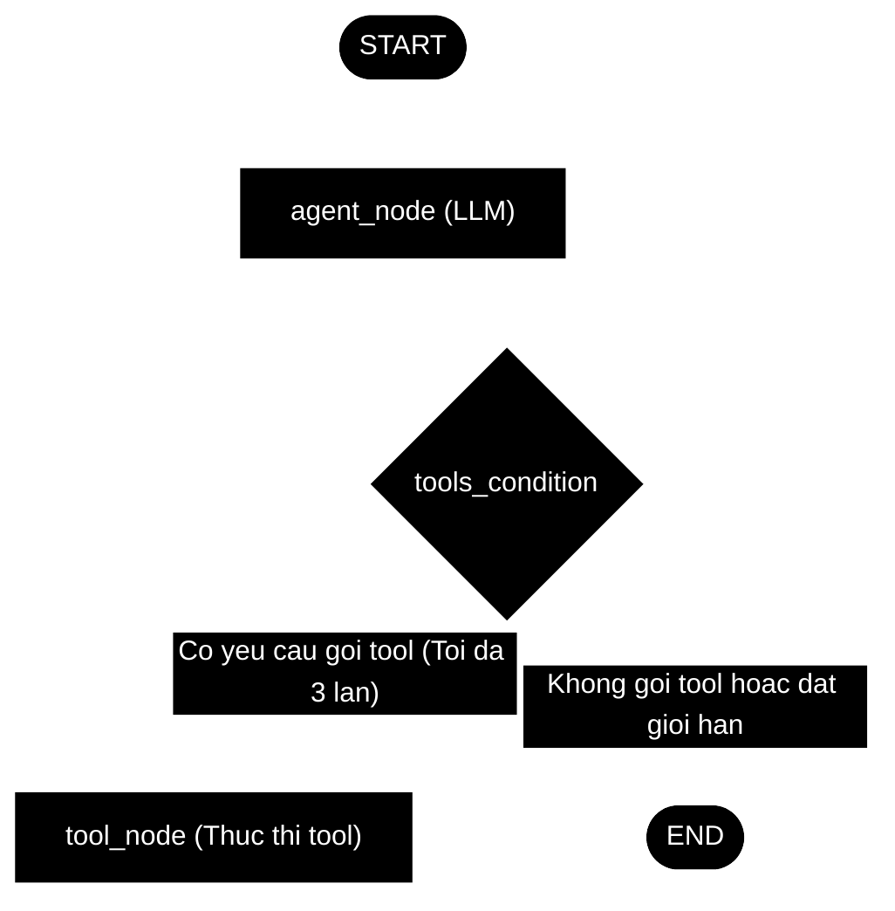
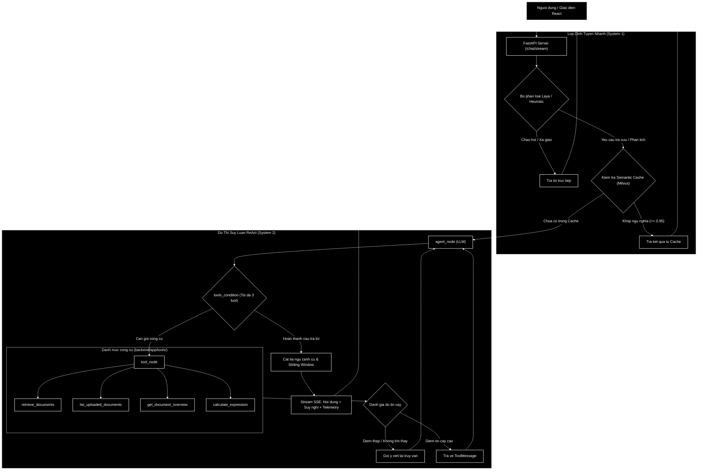
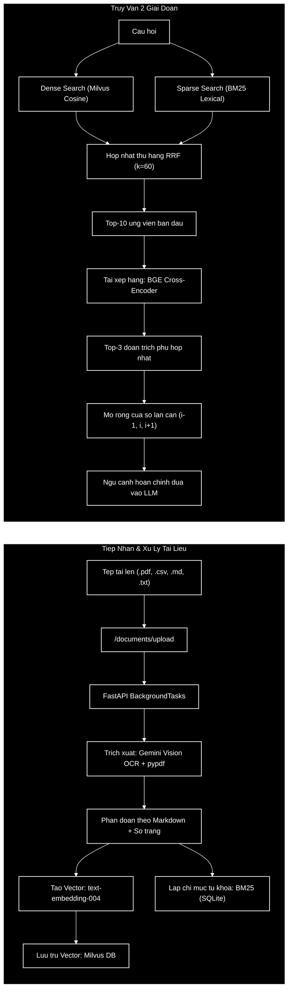

# AI Documents Assistant

[](https://github.com/NguyenVietNguyen2612/ai_documents_assistant/actions/workflows/ci-cd.yml)
[](https://www.python.org/)
[](https://fastapi.tiangolo.com/)
[](https://langchain-ai.github.io/langgraph/)
[](https://milvus.io/)
[](https://react.dev/)
[](backend/auto_tests/)
[](LICENSE)

> **Dự án cá nhân** tìm hiểu và thực hành xây dựng hệ thống trợ lý hỏi đáp tài liệu thông minh (RAG) sử dụng **FastAPI**, **LangGraph ReAct Agent**, **Milvus Vector Database** và giao diện **React**. Dự án tập trung vào việc thử nghiệm các kỹ thuật cải thiện chất lượng tìm kiếm (Hybrid Search, Reranking, Window Expansion) và tối ưu trải nghiệm tương tác với tài liệu.

---

## Mục lục

1. [Giới thiệu & Các tính năng chính](#1-giới-thiệu--các-tính-năng-chính)
2. [Cấu trúc thư mục dự án](#2-cấu-trúc-thư-mục-dự-án)
3. [Cấu trúc hệ thống Agent](#3-cấu-trúc-hệ-thống-agent)
   - [3.1 Sơ đồ kiến trúc Agent](#31-sơ-đồ-kiến-trúc-agent)
   - [3.2 Quản lý trạng thái (AgentState)](#32-quản-lý-trạng-thái-agentstate)
   - [3.3 Vòng lặp ReAct và giới hạn số lần gọi tool](#33-vòng-lặp-react-và-giới-hạn-số-lần-gọi-tool)
   - [3.4 Tách luồng suy luận (Chain-of-Thought)](#34-tách-luồng-suy-luận-chain-of-thought)
   - [3.5 Lưu trữ Checkpoint và Time-Travel](#35-lưu-trữ-checkpoint-và-time-travel)
4. [Kiến trúc luồng xử lý (Two-System Architecture)](#4-kiến-trúc-luồng-xử-lý-two-system-architecture)
5. [Quy trình nạp tài liệu và tìm kiếm kết hợp (2-Stage Hybrid Retrieval)](#5-quy-trình-nạp-tài-liệu-và-tìm-kiếm-kết-hợp-2-stage-hybrid-retrieval)
6. [Thử nghiệm đánh giá hiệu quả (Ablation Study)](#6-thử-nghiệm-đánh-giá-hiệu-quả-ablation-study)
7. [Các lựa chọn thiết kế kỹ thuật](#7-các-lựa-chọn-thiết-kế-kỹ-thuật)
8. [Các công cụ của Agent (Multi-Tool Ecosystem)](#8-các-công-cụ-của-agent-multi-tool-ecosystem)
9. [Kết quả kiểm thử tự động (32/32 tests)](#9-kết-quả-kiểm-thử-tự-động-3232-tests)
10. [Danh mục REST API](#10-danh-mục-rest-api)
11. [Hướng dẫn cài đặt & khởi chạy](#11-hướng-dẫn-cài-đặt--khởi-chạy)
12. [Triển khai với Docker & Kubernetes](#12-triển-khai-với-docker--kubernetes)

---

## 1. Giới thiệu & Các tính năng chính

Dự án được xây dựng nhằm mục đích học tập các khái niệm hiện đại trong xây dựng ứng dụng AI với mô hình Agentic Workflow (LangGraph) thay vì chuỗi RAG cố định, đồng thời áp dụng các giải pháp thực tế để xử lý các vấn đề thường gặp khi làm việc với tài liệu:

- **Hỏi đáp thông minh theo ngữ cảnh tài liệu**:
  - Hỗ trợ tải lên và xử lý nhiều định dạng: `.pdf`, `.csv`, `.md`, `.txt`.
  - Phân tích văn bản kết hợp OCR hình ảnh/bảng biểu (Gemini Vision) và trích xuất cấu trúc đề mục Markdown.
  - Lưu trữ số trang thực tế của từng đoạn văn bản để người dùng có thể nhấp trực tiếp vào nguồn trích dẫn và mở đúng trang PDF tương ứng.
- **Định tuyến 2 cấp (Two-System Routing)**:
  - **Lớp định tuyến nhanh (System 1)**: Nhận diện các câu chào hỏi hoặc câu hỏi thông thường để phản hồi trực tiếp mà không cần khởi tạo luồng ReAct phức tạp.
  - **Lớp suy luận đa bước (System 2)**: Sử dụng LangGraph StateGraph cho các câu hỏi cần tra cứu tài liệu, tính toán hoặc tổng hợp thông tin qua nhiều bước.
- **Tìm kiếm hỗn hợp 2 giai đoạn (2-Stage Hybrid Search)**:
  - Kết hợp Dense Vector Search (Milvus Cosine) với Lexical Search (BM25) thông qua thuật toán Reciprocal Rank Fusion (RRF).
  - Tái chấm điểm và xếp hạng lại (Reranking) top kết quả bằng mô hình Cross-Encoder (`BAAI/bge-reranker-base`) để chọn ra các đoạn văn liên quan nhất.
- **Mở rộng cửa sổ ngữ cảnh (Small-to-Big Window Expansion)**:
  - Tự động ghép nối các đoạn văn lân cận ($i-1, i, i+1$) xung quanh đoạn trích có điểm số cao nhất nhằm tránh mất mát ngữ cảnh ở ranh giới cắt chunk.
- **Cơ chế gợi ý viết lại truy vấn (Corrective RAG)**:
  - Khi điểm tương quan của tài liệu tìm được ở mức thấp, hệ thống kích hoạt cảnh báo để Agent thực hiện diễn đạt lại câu hỏi (Query Rewriting) hoặc dịch thuật ngữ sang tiếng Anh học thuật để thử tra cứu lại.
- **Bộ nhớ đệm ngữ nghĩa (Semantic Cache)**:
  - Lưu trữ các cặp câu hỏi - câu trả lời trên Milvus; khi người dùng đặt câu hỏi có ý nghĩa tương đương ($\ge 0.95$), hệ thống có thể phản hồi nhanh từ cache mà không cần gọi lại LLM.
- **Xử lý tài liệu ngầm (Async Background Ingestion)**:
  - Quá trình đọc file, OCR, chia đoạn và tạo vector được đưa vào `BackgroundTasks` của FastAPI.
  - Phản hồi HTTP ngay lập tức và hỗ trợ giao diện polling trạng thái xử lý theo thời gian thực (2 giây/lần).
- **Trải nghiệm giao diện (UI/UX)**:
  - Hỗ trợ gắn thẻ `@tài_liệu` để giới hạn phạm vi tìm kiếm vào một tài liệu cụ thể.
  - Tách luồng suy luận `<think>...</think>` (Chain-of-Thought) hiển thị riêng biệt qua Server-Sent Events (SSE).
  - Hiển thị thanh thông số kỹ thuật (Telemetry) dưới mỗi câu trả lời: thời gian xử lý, điểm rerank, số bước gọi công cụ và nguồn trích dẫn.

---

## 2. Cấu trúc thư mục dự án

```
ai_documents_assistant/
├── backend/
│   ├── app/
│   │   ├── api/routes/          # Các endpoint: chat, documents, health
│   │   ├── graph/               # Định nghĩa đồ thị LangGraph (state, rag_graph, nodes)
│   │   ├── schemas/             # Pydantic models xác thực dữ liệu request/response
│   │   ├── services/            # Dịch vụ xử lý: agent, db, document, retriever, bm25, reranker, cache...
│   │   ├── tools/               # Các công cụ của Agent: retrieve, list, overview, calculator
│   │   └── main.py              # Điểm khởi chạy ứng dụng FastAPI và vòng đời hệ thống
│   ├── app_data/                # File cơ sở dữ liệu SQLite cục bộ (lịch sử chat, checkpoint, metadata)
│   ├── auto_tests/              # Bộ 32 bài kiểm thử tự động (unit, integration, tools, cache, stream)
│   ├── evaluation/              # Pipeline RAGOps đánh giá định lượng (dataset, target, ablation_study)
│   ├── Dockerfile               # Cấu hình container cho backend
│   ├── requirements.txt         # Danh sách thư viện Python
│   └── .env                     # File cấu hình biến môi trường
│
├── frontend/
│   ├── src/
│   │   ├── components/          # Các component React: ChatBox, DocumentList, PDFModal, Sidebar...
│   │   ├── services/            # Xử lý gọi API và nhận SSE stream
│   │   ├── App.jsx              # Giao diện chính 3 cột
│   │   └── App.css              # Định dạng giao diện
│   ├── package.json             # Danh sách dependencies của frontend
│   └── vite.config.js           # Cấu hình Vite dev server và build
│
├── .github/workflows/           # Cấu hình CI/CD GitHub Actions (ci-cd.yml)
├── k8s/                         # Các file cấu hình triển khai Kubernetes (config, deployment, service)
├── docker-compose.yml           # Khởi động Milvus, etcd, MinIO, Backend và Frontend
├── start.sh                     # Script khởi chạy nhanh cho môi trường Linux / macOS
├── start.bat                    # Script khởi chạy nhanh cho môi trường Windows
└── README.md                    # Tài liệu hướng dẫn dự án
```

---

## 3. Cấu trúc hệ thống Agent

Hệ thống sử dụng thư viện LangGraph để quản lý luồng hội thoại dưới dạng đồ thị trạng thái (StateGraph).

### 3.1 Sơ đồ kiến trúc Agent



Mô tả các thành phần và cạnh (edge) trong đồ thị:
- `START -> agent_node`: Đưa câu hỏi và danh sách tin nhắn lịch sử vào node xử lý chính.
- `agent_node (LLM)`: Mô hình ngôn ngữ nhận ngữ cảnh, phân tích yêu cầu và quyết định: xuất câu trả lời trực tiếp hoặc phát tín hiệu gọi công cụ.
- `tools_condition`: Cạnh điều kiện kiểm tra phản hồi từ LLM:
  - Nếu LLM yêu cầu gọi công cụ và số lượt gọi chưa vượt quá 3 lần: Chuyển tiếp sang `tool_node`.
  - Nếu không cần gọi công cụ hoặc đã đạt giới hạn 3 lần gọi: Chuyển sang `END`.
- `tool_node -> agent_node`: Sau khi thực thi công cụ xong, kết quả (`ToolMessage`) được gửi ngược lại về `agent_node` để mô hình tổng hợp câu trả lời cuối cùng.

### 3.2 Quản lý trạng thái (AgentState)

Trạng thái của Agent được định nghĩa thông qua kiểu dữ liệu `AgentState`:
- Sử dụng danh sách tin nhắn có reducer `add_messages` để nối tiếp các tin nhắn mới (`HumanMessage`, `AIMessage`, `ToolMessage`, `SystemMessage`) vào ngữ cảnh chung của cuộc trò chuyện.
- Lưu trữ các biến cờ điều khiển luồng như số lượt gọi công cụ hiện tại (`tool_call_count`).

### 3.3 Vòng lặp ReAct và giới hạn số lần gọi tool

- Khi người dùng hỏi thông tin cần tra cứu dữ liệu, Agent phát lệnh gọi công cụ (ví dụ `retrieve_documents`, `calculate_expression`).
- Nhằm tránh tình trạng mô hình rơi vào vòng lặp gọi công cụ vô hạn khi không tìm thấy thông tin hoặc tìm kiếm không khớp, hệ thống đặt giới hạn tối đa **3 lần gọi công cụ**. Khi chạm ngưỡng này, hệ thống dừng tìm kiếm và yêu cầu mô hình phản hồi dựa trên thông tin hiện có.

### 3.4 Tách luồng suy luận (Chain-of-Thought)

- Trong System Prompt, mô hình được hướng dẫn tạo phần suy nghĩ bên trong cặp thẻ `<think>...</think>` trước khi đưa ra câu trả lời chính thức.
- Tầng backend xử lý luồng stream (SSE) bóc tách các token trong thẻ `<think>` để gửi riêng về client dưới dạng sự kiện suy nghĩ, giúp giao diện hiển thị phần phân tích tách biệt với câu trả lời.

### 3.5 Lưu trữ Checkpoint và Time-Travel

- Sử dụng `AsyncSqliteSaver` để lưu trữ snapshot của từng bước thực thi vào file SQLite (`app_data/checkpoints.db`).
- Hỗ trợ khôi phục phiên làm việc và quay lui (rollback) trạng thái hội thoại về một tin nhắn bất kỳ trong quá khứ.

---

## 4. Kiến trúc luồng xử lý (Two-System Architecture)

Luồng điều phối hội thoại kết hợp giữa lớp phân loại nhanh và đồ thị trạng thái LangGraph:



---

## 5. Quy trình nạp tài liệu và tìm kiếm kết hợp (2-Stage Hybrid Retrieval)



- **Quy trình nạp tài liệu**:
  1. Khi người dùng tải tệp lên, hệ thống phản hồi ngay mã tài liệu và trạng thái `processing`.
  2. Tác vụ ngầm thực hiện OCR nhận diện văn bản, cấu trúc bảng biểu và trích xuất số trang.
  3. Nội dung được chia đoạn theo phân cấp tiêu đề Markdown (`#`, `##`, `###`) để giữ ngữ cảnh phân mục.
  4. Lưu đồng thời vector vào Milvus và từ khóa vào chỉ mục BM25 cục bộ.
- **Hợp nhất kết quả bằng RRF**:
  Sử dụng công thức Reciprocal Rank Fusion với hằng số $k = 60$ để kết hợp thứ hạng từ Dense Vector và BM25:
  $$\text{RRF\_Score}(d) = \sum_{m \in \{\text{dense}, \text{bm25}\}} \frac{1}{k + \text{rank}_m(d)}$$
- **Reranker với Cross-Encoder**:
  Mô hình `BAAI/bge-reranker-base` chấm điểm trực tiếp cặp `(Câu hỏi, Đoạn trích)` để chọn ra top kết quả có độ tương quan ngữ nghĩa cao nhất.
- **Mở rộng cửa sổ (Window Expansion)**:
  Lấy thêm các đoạn liền kề trước và sau đoạn trích tốt nhất giúp mô hình nắm được câu văn hoàn chỉnh, hạn chế việc bị cắt đứt giữa câu hoặc mất phần giải thích công thức.

---

## 6. Thử nghiệm đánh giá hiệu quả (Ablation Study)

Để kiểm tra xem việc kết hợp BM25 và Cross-Encoder có thực sự cải thiện khả năng tìm kiếm so với chỉ dùng Vector đơn thuần hay không, dự án thực hiện đo lường trên bộ câu hỏi thử nghiệm ([`backend/evaluation/dataset.json`](backend/evaluation/dataset.json)) với các dạng truy vấn khác nhau (từ khóa đặc thù, tên riêng, câu hỏi ngữ nghĩa):

| Phương pháp truy xuất | Hit Rate@1 | Hit Rate@3 | MRR@3 | Độ phủ từ khóa | Thời gian trung bình |
| :--- | :---: | :---: | :---: | :---: | :---: |
| **Chỉ dùng Dense Vector (Milvus)** | 90.0% | 90.0% | 0.900 | 96.0% | **~38 ms** |
| **Tìm kiếm kết hợp (Milvus + BM25 RRF)** | 90.0% | **100.0%** | 0.950 | **100.0%** | ~47 ms |
| **Kết hợp + Tái xếp hạng (Hybrid + BGE Reranker)** | **100.0%** | **100.0%** | **1.000** | **100.0%** | ~142 ms |

> [!NOTE]
> **Ghi nhận từ kết quả thử nghiệm:**
> - Phương pháp chỉ dùng Vector gặp khó khăn ở các câu hỏi chứa mã định danh học thuật chính xác (ví dụ các tên viết tắt kỹ thuật) do vector embedding có xu hướng dàn đều ngữ nghĩa.
> - Khi bổ sung BM25 thông qua RRF, toàn bộ tài liệu mục tiêu đều xuất hiện trong Top-3 kết quả tìm kiếm.
> - Bước tái xếp hạng bằng BGE Cross-Encoder giúp đưa đoạn trích chính xác nhất lên vị trí Top-1 trong các ca thử nghiệm, tuy nhiên thời gian phản hồi tăng thêm khoảng 95ms do mô hình Cross-Encoder cần xử lý qua nhiều lớp attention.

---

## 7. Các lựa chọn thiết kế kỹ thuật

Trong quá trình phát triển, một số giải pháp kỹ thuật đã được cân nhắc để cân đối giữa chi phí, thời gian xử lý và độ chính xác:

1. **Lớp định tuyến nhanh (System 1)**:
   - Các câu chào hỏi hoặc giao tiếp ngắn không cần thiết phải chạy qua chuỗi suy luận ReAct. Việc phân loại sớm giúp phản hồi ngay cho người dùng và giảm bớt số lần gọi API bên ngoài.
2. **Sử dụng thuật toán RRF thay vì chuẩn hóa điểm**:
   - Điểm số Cosine Similarity và điểm BM25 có phân phối và biên độ khác nhau. Thay vì cố gắng co giãn điểm số vốn dễ bị ảnh hưởng bởi giá trị ngoại lai, RRF dựa trên thứ tự xếp hạng giúp kết quả ổn định hơn.
3. **Mở rộng cửa sổ ngữ cảnh (Window Expansion)**:
   - Cắt đoạn văn bản ngắn (khoảng 800 - 1000 ký tự) giúp vector nhạy hơn trong việc nắm bắt ý chính. Sau khi tìm được vị trí phù hợp, việc kéo thêm đoạn trước và đoạn sau vào prompt giúp câu trả lời của mô hình có đủ ngữ cảnh mà không làm giảm độ chính xác lúc tìm kiếm.
4. **Bộ nhớ đệm ngữ nghĩa (Semantic Cache)**:
   - Đối với các câu hỏi tương tự nhau về mặt ngữ nghĩa (ngưỡng Cosine $\ge 0.95$), hệ thống có thể trả lời trực tiếp từ cache. Cache sẽ tự động được xóa khi có tài liệu mới tải lên hoặc bị xóa để tránh trả lời bằng dữ liệu cũ.
5. **Cắt tỉa ngữ cảnh cũ (ToolMessage Pruning)**:
   - Trong các cuộc trò chuyện kéo dài, kết quả tra cứu của các lượt chat trước chiếm rất nhiều dung lượng token. Rút gọn các kết quả cũ về dạng tóm tắt ngắn giúp giữ cho cửa sổ ngữ cảnh luôn nằm trong giới hạn hợp lý.
6. **Xử lý tài liệu ngầm (Background Ingestion)**:
   - Việc OCR và tạo embedding cho các tài liệu dài có thể mất từ 15 đến 30 giây. Việc đưa công việc này vào background task giúp người dùng không phải chờ đợi ở màn hình upload và có thể tiếp tục thao tác khác.

---

## 8. Các công cụ của Agent (Multi-Tool Ecosystem)

Các công cụ được tổ chức tách biệt tại thư mục [`backend/app/tools/`](backend/app/tools/):

- **`retrieve_documents`**: Tra cứu đoạn văn bản liên quan trong tài liệu (kết hợp Milvus, BM25, Reranker và mở rộng cửa sổ).
- **`list_uploaded_documents`**: Liệt kê danh sách các tài liệu hiện có kèm số lượng trang và trạng thái.
- **`get_document_overview`**: Lấy thông tin tóm tắt và cấu trúc các đề mục chính của một tài liệu cụ thể.
- **`calculate_expression`**: Hỗ trợ tính toán các phép toán số học (`+`, `-`, `*`, `/`, `**`, `%`, `round`). Sử dụng thư viện `ast` (Abstract Syntax Tree) của Python để phân tích cú pháp an toàn, không sử dụng hàm `eval()`.

---

## 9. Kết quả kiểm thử tự động (32/32 tests)

Dự án có sẵn bộ script kiểm thử tự động để kiểm tra các thành phần từ backend API, dịch vụ xử lý tài liệu đến luồng stream SSE:

```bash
# Thực thi toàn bộ kiểm thử
python backend/auto_tests/run_all_tests.py
```

| STT | Tập tin kiểm thử | Số test | Nội dung kiểm tra | Trạng thái |
| :---: | :--- | :---: | :--- | :---: |
| 1 | [`test_unit_retriever_bm25.py`](backend/auto_tests/test_unit_retriever_bm25.py) | **7** | Tìm kiếm Milvus, BM25, RRF, Reranker, Window Expansion, Corrective RAG | ✅ PASS |
| 2 | [`test_unit_semantic_cache_and_pruning.py`](backend/auto_tests/test_unit_semantic_cache_and_pruning.py) | **4** | Semantic Cache trên Milvus, xóa cache, cắt tỉa ToolMessage và Sliding Window | ✅ PASS |
| 3 | [`test_integration_api.py`](backend/auto_tests/test_integration_api.py) | **6** | API upload ngầm, polling trạng thái, xóa file, phạm vi `@tài_liệu`, quản lý phiên | ✅ PASS |
| 4 | [`test_integration_chat_stream.py`](backend/auto_tests/test_integration_chat_stream.py) | **3** | Luồng stream SSE, định dạng chunk suy nghĩ `<think>`, sự kiện telemetry | ✅ PASS |
| 5 | [`test_tools.py`](backend/auto_tests/test_tools.py) | **5** | Khả năng kích hoạt công cụ của Agent, máy tính AST an toàn, Document Overview | ✅ PASS |
| 6 | [`test_unit_laya_router.py`](backend/auto_tests/test_unit_laya_router.py) | **4** | Phân loại câu chào hỏi, ngưỡng tự tin tối thiểu (guardrail), fallback | ✅ PASS |
| 7 | [`test_unit_db_documents.py`](backend/auto_tests/test_unit_db_documents.py) | **3** | Cập nhật cấu trúc SQLite, đồng bộ dữ liệu giữa SQLite và Milvus | ✅ PASS |
| **Tổng cộng** | **7 Modules** | **32 tests** | **Kiểm tra chức năng toàn diện** | **32/32 (100%)** |

---

## 10. Danh mục REST API

| Phương thức | Đường dẫn | Chức năng |
| :--- | :--- | :--- |
| `GET` | `/health` | Kiểm tra trạng thái hoạt động của backend |
| `GET` | `/documents` | Lấy danh sách tài liệu kèm trạng thái (`processing`, `ready`, `error`) |
| `POST` | `/documents/upload` | Tải lên tài liệu mới (.pdf, .csv, .md, .txt) và xử lý ở chế độ nền |
| `GET` | `/documents/{id}/status` | Kiểm tra tiến trình xử lý của tài liệu |
| `GET` | `/documents/{id}/view` | Xem nội dung hoặc tải file tài liệu để hiển thị |
| `DELETE` | `/documents/{id}` | Xóa tài liệu khỏi database, vector store và xóa cache liên quan |
| `POST` | `/chat/stream` | Gửi câu hỏi và nhận stream phản hồi qua SSE (hỗ trợ `@tài_liệu`, CoT, Telemetry) |
| `POST` | `/chat` | Gửi câu hỏi nhận phản hồi dạng JSON thông thường |
| `POST` | `/chat/cache/clear` | Xóa dữ liệu cache ngữ nghĩa trên Milvus |
| `GET` | `/chat/sessions` | Lấy danh sách các phiên trò chuyện |
| `POST` | `/chat/sessions` | Tạo phiên trò chuyện mới |
| `GET` | `/chat/sessions/{id}/messages` | Lấy lịch sử tin nhắn của một phiên |
| `DELETE` | `/chat/sessions/{id}` | Xóa phiên trò chuyện và các checkpoint tương ứng |
| `POST` | `/chat/rollback` | Quay lui trạng thái hội thoại về một tin nhắn cụ thể |

---

## 11. Hướng dẫn cài đặt & khởi chạy

### Yêu cầu môi trường:
- Python 3.10 trở lên (khuyến nghị 3.12).
- Node.js 18 trở lên và npm.
- Docker Desktop (dùng để chạy cơ sở dữ liệu Milvus).
- Khóa API của Google Gemini.

### Bước 1: Cấu hình biến môi trường
Tạo tệp `backend/.env` với các thông tin cơ bản:
```env
GEMINI_API_KEY=dien_api_key_cua_ban_o_day
GEMINI_MODEL=gemini-2.5-flash
MILVUS_URI=http://localhost:19530
PORT=8001
HOST=0.0.0.0
```

### Bước 2: Khởi chạy nhanh bằng script

- **Trên Linux / macOS**:
  ```bash
  chmod +x start.sh
  ./start.sh
  ```
- **Trên Windows**:
  Chạy tệp `start.bat` từ Command Prompt hoặc PowerShell:
  ```cmd
  start.bat
  ```

*Script sẽ tự động khởi động các container phụ trợ của Milvus, chuẩn bị môi trường ảo Python, cài đặt thư viện và mở Backend (cổng 8001) cùng Frontend (cổng 3000).*

### Bước 3: Khởi chạy thủ công từng phần

1. **Khởi động Milvus qua Docker**:
   ```bash
   docker compose up -d standalone
   ```

2. **Cài đặt và chạy Backend**:
   ```bash
   cd backend
   python -m venv .venv
   source .venv/bin/activate       # Trên Windows: .venv\Scripts\activate
   pip install -r requirements.txt
   uvicorn app.main:app --reload --port 8001
   ```

3. **Cài đặt và chạy Frontend**:
   ```bash
   cd frontend
   npm install
   npm run dev
   ```

---

## 12. Triển khai với Docker & Kubernetes

### Chạy bằng Docker Compose:
```bash
docker compose up --build
```
Lệnh này sẽ khởi động đầy đủ các dịch vụ gồm Milvus (kèm etcd, MinIO), Backend FastAPI và Frontend React.

### Triển khai trên Kubernetes:
Các tệp cấu hình triển khai cơ bản nằm trong thư mục [`k8s/`](k8s/):
```bash
# 1. Áp dụng ConfigMap
kubectl apply -f k8s/backend-config.yaml

# 2. Triển khai Backend
kubectl apply -f k8s/backend-deployment.yaml

# 3. Triển khai Frontend
kubectl apply -f k8s/frontend-deployment.yaml
```

---

## Giấy phép (License)
Dự án được phân phối dưới giấy phép mã nguồn mở **MIT License**.
